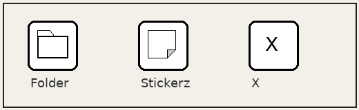
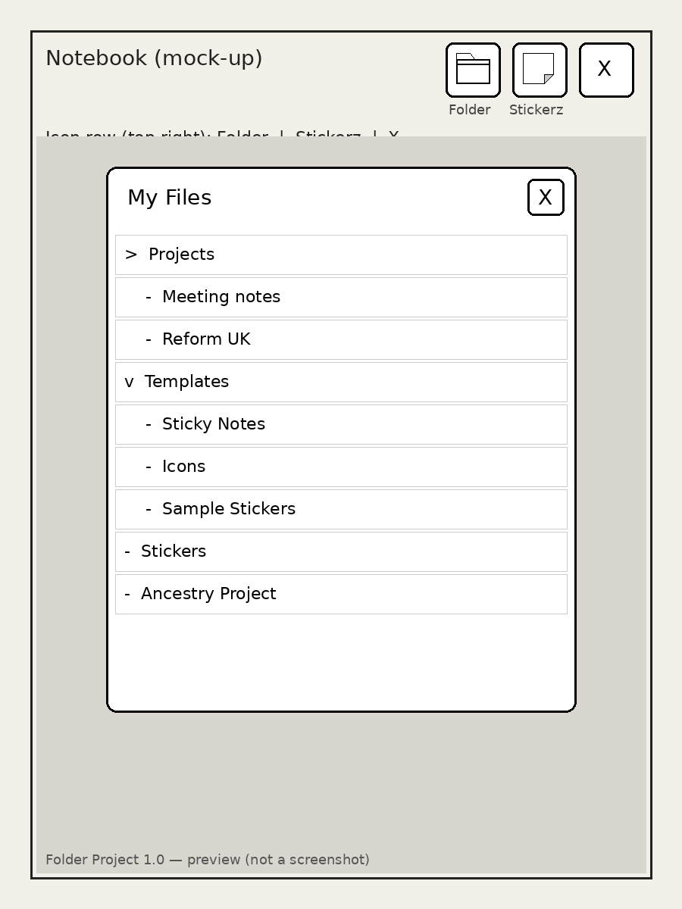

# Foldz


Foldz is Nick Greenfield's My Files popup and go/return mod for the reMarkable Paper Pro. It adds a folder button on every open document so you can open another notebook from a My Files tree, lasso-copy handwriting, return, and paste. This repository is version **1.0**. It has been tested on Nick's Paper Pro, firmware **3.28.0.172**.

It sits next to [Stickerz](https://github.com/nickgeenfield/Stickerz) (separate `.qmd`; either can be installed alone).

## How it works

1. In any open document, tap the **folder** icon at the **top right**, immediately **left of the Stickerz** sticker icon.
2. A popup lists the whole **My Files** tree (folders expand and collapse; notebooks are listed).
3. Tap a notebook: Foldz remembers your current document and page, then opens the chosen notebook.
4. Use the normal **lasso / selection** tool, select handwriting, and **Copy**.
5. Tap the **back-to-document** icon at the **top right** (same slot as the folder icon). You return to where you were.
6. **Paste** into your document.

The clipboard survives the switch (same as Stickerz).

| Button | Design |
| --- | --- |
| Open My Files | Folder with tab |
| Back | Left arrow pointing at a lined document page |

Both icons are drawn in QML with plain `Canvas` (black on white for e-ink), 88×88, with `topMargin: 16` and `rightMargin: 220` (Stickerz uses `120`).

<p align="center">
  
</p>

<p align="center">
  
</p>

## Requirements

- A reMarkable Paper Pro on firmware **3.28** (tested on **3.28.0.172**), with developer mode on.
- [XOVI](https://github.com/asivery/rm-xovi-extensions) and **qt-resource-rebuilder**, already installed and working (for example via [reManager](https://github.com/asivery/rm-xovi-extensions)).
- A Windows 10 or Windows 11 PC. Over USB, the installer's default address `10.11.99.1` works. Over Wi-Fi, use the tablet's IP.

## Installation (Windows installer)

1. Download `Foldz-1.0-Setup.zip` from the [Releases](https://github.com/nickgeenfield/Foldz/releases) page and extract it. The program is `Foldz-1.0-Setup.exe`.
2. Windows SmartScreen may warn that it does not recognise the app. Choose **More info**, then **Run anyway**.
3. Plug the tablet in by USB (or join the same Wi-Fi) and unlock it.
4. The SSH user is `root`. The password is under **Settings > General > About > Copyrights and licences** (scroll to the bottom). Developer mode is required. The password is case-sensitive and can change after a software update.
5. Run `Foldz-1.0-Setup.exe`. Enter the IP address (default `10.11.99.1`), the user `root`, and the password. The password is masked as you type and is **never stored**.
6. When the menu appears, choose:
   - **1** — Install or update Foldz
   - **2** — Uninstall Foldz
7. After install, in **reManager**: **rebuild the hashtab**, then **restart XOVI / xochitl**. The installer does **not** restart the UI for you.

Upgrading from the earlier working name **Folder Project** (`folders.qmd`) is supported: `install.sh` moves `folders.qmd` into a backup first so only `foldz.qmd` loads (no duplicate icons).

## Manual install

1. Download `Foldz-1.0.zip` from [Releases](https://github.com/nickgeenfield/Foldz/releases) and extract it so you have a `Foldz-1.0` folder containing `install.sh`.
2. Copy it to the tablet:

```sh
scp -r Foldz-1.0 root@10.11.99.1:/home/root/foldz
```

3. SSH in and run:

```sh
sh /home/root/foldz/install.sh
```

4. In **reManager**: rebuild the hashtab, then restart XOVI / xochitl.

### What install.sh does

- Prints the firmware version.
- Backs up `exthome/qt-resource-rebuilder` to `/home/root/foldz-backup-<time>/` before changing anything.
- Never overwrites a file it did not create (or that does not look like Foldz / Folder Project).
- Moves `folders.qmd` (Folder Project) into the backup so both mods do not load.
- Leaves `stickerz.qmd` and every other mod alone.
- Leaves `extensions.d` alone.
- Installs `/home/root/xovi/exthome/qt-resource-rebuilder/foldz.qmd`.
- Records created paths in `/home/root/xovi/foldz.manifest`.

## Uninstall

```sh
sh /home/root/foldz/uninstall.sh
```

Or run the Windows installer and choose **2**.

That removes only what is listed in the Foldz (and leftover Folder Project) manifest. Afterwards, rebuild the hashtab and restart in reManager.

## If it goes wrong

XOVI is tethered. If a hash does not resolve, xochitl can crash-loop and the tablet reboots to stock (no mods).

1. SSH in: `ssh root@10.11.99.1`
2. Run `sh /home/root/foldz/uninstall.sh`  
   or delete `/home/root/xovi/exthome/qt-resource-rebuilder/foldz.qmd`  
   (and `folders.qmd` if it is still present)
3. Rebuild the hashtab and restart XOVI in reManager.

## Repository layout

| Path | Contents |
| --- | --- |
| `src/foldz.qmd` | The QML mod loaded by qt-resource-rebuilder |
| `install.sh` / `uninstall.sh` | On-tablet install and uninstall |
| `installer/` | Go source for the Windows installer (payload embeds the files above) |
| `assets/` | Icons and previews used on this page and by the installer |

Build outputs (`.exe`, `.zip`, `.syso`) are **not** committed. Download them from [Releases](https://github.com/nickgeenfield/Foldz/releases).

## Licence

GPL-3.0-or-later. Author: Nick Greenfield. See [LICENSE](LICENSE).

Approaches derived from / credits:

- alefaraci / linkFromSelection and navHistory (GPL-3.0-only)
- ingatellent FolderListModel / explorer.open patterns (**GPL-2.0-or-later**) — credit kept; their SceneAssistant native path is **not** used
- FouzR / Stickerz 1.0 overlay pattern (GPL-3.0-or-later)

XOVI and qt-resource-rebuilder: [asivery](https://github.com/asivery).

### Evidence / provenance

- **AFFECT `8850026134298937527` / open-doc helper** and **AFFECT `11806562588218124596` / DocumentView overlay**: same targets as Stickerz 1.0 and alefaraci `linkFromSelection.qmd` (3.28).
- **`requestOpenDocumentOnPage`** `9497240032101537789`: linkFromSelection 3.28 / Stickerz (used for precise return-to-page).
- **`navigator.explorer.open`** `7712989590835962` / `6504147419`: navHistory 3.28 / ingatellent fourFingerSwipeForLastDoc (used when picking from the tree).
- **Library `entryForId`** `233694067165438` / `8399431778896295215`: linkFromSelection / navHistory 3.28.
- **Page jump** `7713405014271992` + enum path: linkFromSelection 3.28.
- **FolderListModel IMPORT** `180923.180930`, **folder** `7082663378949`, **count** `214622615378`, **get** `197086313`, **Name** `6502945418`: imageStickers / stickers 3.28.
- **XMLHttpRequest open/send** `6504147419` / `6504279475`, **JSON.parse** `6502785411`: linkFromSelection 3.28.
- Plain QtQuick types (`Item`, `Rectangle`, `MouseArea`, `Text`, `Timer`, `Canvas`, `Flickable`, `Column`, `Repeater`) are unhashed.
